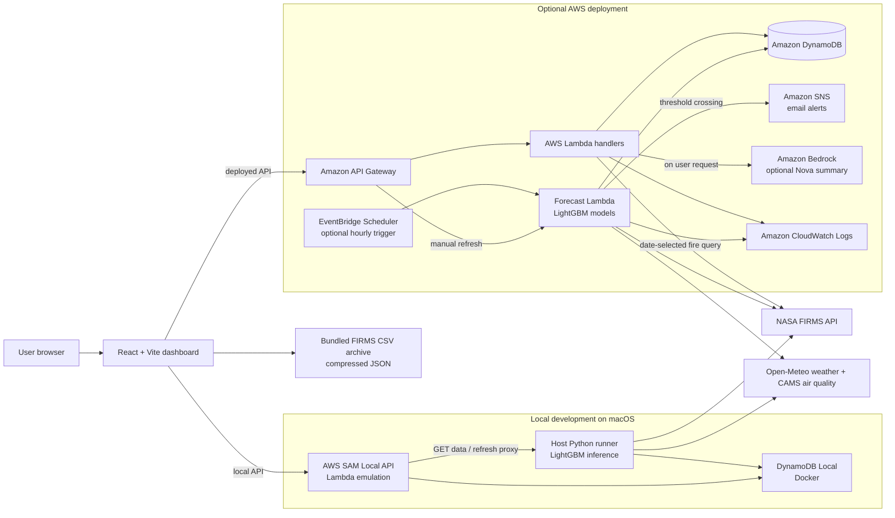

# Stubble Smoke Forecaster

A local-first air-quality and fire-activity dashboard for the Delhi–Punjab–Haryana region. It combines 24- and 48-hour PM2.5 forecasts from trained LightGBM quantile models, NASA FIRMS satellite fire detections, historical seasonal context, optional AI-generated summaries, and threshold-based email alerts.

> Forecasts, satellite hotspots, and seasonal comparisons are different data products. The CAMS PM2.5 value is a model input, not a ground-monitor reading. A satellite hotspot does not establish the cause of a fire or prove crop-residue burning.

## What the app does

- **Air-quality outlook:** displays 24- and 48-hour quantile forecasts (q10/q50/q90) and uncertainty ranges.

- **Fire activity map:** requests date-specific NASA FIRMS data, including supported near-real-time and standard archived products, and displays hotspot locations, FRP, confidence, and sensor information.

- **Historical season monitor:** charts daily and yearly FIRMS counts, compares a date with the same calendar date in other years, and flags unusual activity. The bundled archive currently covers October–November 2016–2025.

- **Forecast history:** stores model runs, shows changes between successive forecasts, and compares 24-hour with 48-hour outlooks.

- **Natural-language summary:** optionally calls Amazon Bedrock Nova Micro when a user requests a summary; a rules-based summary is available as a fallback.

- **Email alerts:** publishes to Amazon SNS when a 24- or 48-hour q90 forecast reaches the configured PM2.5 threshold. Alert state is stored to avoid repeated mail for every high run.

- **Dashboard:** responsive React UI with English, Hindi, and Punjabi, light/dark themes, charts, and an interactive map.

## Architecture

The same React dashboard can use either the local development stack or the deployed AWS API. Forecast inputs and fire detections come from external data providers; forecasts and alert state are stored separately from the static historical-season archive.



In local mode, SAM runs the HTTP handlers in Docker while the Python process on the Mac performs model inference and writes to DynamoDB Local. In AWS mode, API Gateway routes requests to Lambda; a forecast Lambda can also run hourly through EventBridge Scheduler. Bedrock summaries and scheduled runs are optional. SAM/CloudFormation provisions the AWS resources; the diagram focuses on runtime requests and data flow.

## AWS services and tools used

### AWS services in the SAM template

| AWS service/tool | How this project uses it | Required? |
| --- | --- | --- |
| **AWS Lambda** | Runs the forecast worker and the HTTP handlers for latest forecast, history, fire-map requests, summaries, and manual refresh. | Yes for AWS deployment; local alternatives are available. |
| **Amazon API Gateway** | Exposes `/latest`, `/history`, `/fires`, `/summary`, and `/refresh` endpoints to the dashboard. | Yes for the deployed API. |
| **Amazon DynamoDB** | Stores the latest forecast, timestamped forecast history, and alert-deduplication state. The table uses pay-per-request billing and encryption at rest in the template. | Yes for the AWS backend. |
| **Amazon SNS** | Sends email notifications through an existing standard SNS topic. Recipients must confirm their email subscription. | Required for email alerts; other dashboard features can run without it. |
| **Amazon EventBridge Scheduler** | Optionally invokes the forecast worker hourly. The schedule can be disabled for student accounts that do not permit it. | Optional; manual refresh remains available. |
| **Amazon Bedrock** | Optionally invokes the configured Amazon Nova Micro model to write a data-grounded summary. | Optional; the rules-based fallback does not require Bedrock. |
| **AWS IAM** | Gives each Lambda only the permissions it needs, including DynamoDB access, SNS publish, optional Bedrock invocation, and execution logging. | Created/used by the SAM stack; your account must permit the required roles and policies. |
| **Amazon CloudWatch Logs** | Receives Lambda execution and diagnostic logs through the Lambda execution role. | Used by deployed Lambdas for troubleshooting. |
| **Amazon S3 (SAM deployment bucket)** | Stores packaged Lambda artifacts during `sam deploy --resolve-s3`. SAM can create/manage this deployment bucket. | Used for SAM packaging/deployment. |
| **AWS CloudFormation** | Creates and updates the stack from `template.yaml`; AWS SAM transforms the template into CloudFormation resources. | Yes for this SAM deployment path. |

**AWS developer tools:** AWS CLI v2 is used to inspect the caller identity, check SNS subscriptions, and query stack outputs. AWS SAM CLI builds and runs the application locally and deploys the CloudFormation stack. The Python backend uses **boto3**, the AWS SDK for Python, to access DynamoDB and SNS and to invoke Bedrock when enabled. **Docker Desktop** runs DynamoDB Local and SAM's Lambda containers during local development.

### Other development tools and libraries

| Area | Tools |
| --- | --- |
| Frontend | React 19, Vite, Recharts, Leaflet / React-Leaflet, Lucide icons |
| Backend/runtime | Python 3.12, AWS SAM, API Gateway Lambda proxy handlers |
| Forecasting/data processing | LightGBM, pandas, NumPy, SciPy |
| HTTP/API access | Python `requests` and standard-library HTTP clients; boto3 for AWS SDK calls |
| Local services | Docker Compose, DynamoDB Local, SAM Local, host-side Python forecast runner |
| Quality checks | ESLint, Vite production build, Python `unittest` regression tests |

The local development path runs LightGBM inference on the host machine and persists to DynamoDB Local. In AWS, the forecast Lambda packages the trained models. Depending on AWS account permissions and Lambda package-size limits, keep inference local if deployment is unavailable.

## Data sources and lineage

| Source | Data used in this project | Credential / notes |
| --- | --- | --- |
| **NASA FIRMS** | VIIRS active-fire/thermal-anomaly detections for the live/date-selected Fire Map and recent fire inputs to the forecast pipeline. The API checks product availability and selects supported near-real-time or standard products. | Requires a NASA FIRMS MAP_KEY in `FIRMS_KEY`. FIRMS detections are not fire-cause labels. |
| **Open-Meteo Forecast API** | Hourly Delhi weather features such as temperature, humidity, precipitation, wind, and boundary-layer height for the runtime forecast. | No API key is configured by this project for this endpoint; availability and terms are governed by Open-Meteo. |
| **Open-Meteo Air Quality API (CAMS)** | Hourly CAMS PM2.5 model data used as a baseline/input to the forecast. The UI explicitly distinguishes it from a ground-station observation. | No API key is configured by this project for this endpoint; availability and terms are governed by Open-Meteo. |
| **Open-Meteo Historical Weather Archive** | Historical weather features used by the data-preparation/training utilities. | No project API key; verify historical variable coverage when rebuilding training data. |
| **OpenAQ v3 (optional helper)** | The repository includes a helper for retrieving station PM2.5 measurements for historical research/validation. It is not called by the normal live forecast path. | An OpenAQ API key is needed only if you call that helper; see `OPENAQ_KEY`. |
| **Included project FIRMS CSVs** | Source for the bundled October–November seasonal archive and gridded historical map. The site serves compressed and plain JSON generated from the CSVs. | No runtime API key is needed to read the bundled archive. Missing dates are unknown, not zero. |
| **Trained LightGBM artifacts** | Six quantile-model files produce q10/q50/q90 estimates for the 24-hour and 48-hour horizons. | Model files are included under `models/` and copied under `src/models/` for SAM packaging. They are project artifacts, not an external hosted model service. |

The standard archived FIRMS product can lag real time. NASA's Area API accepts 1–5 days per request; `days=1` means a one-day query, not a last-five-days-only limit. NASA may have a gap for a particular date/product. The bundled archive is limited to its listed date coverage and is not a complete historical replacement. Annual counts depend on sensor/product coverage and processing, so cross-year comparisons need care.

## Quick start: macOS

For the full beginner guide, AWS deployment commands, alert subscription instructions, troubleshooting, and cleanup, see [**START_HERE_MACOS.md**](START_HERE_MACOS.md).

### 1. Install the tools

- Python 3.12

- Node.js 20+ (22 recommended)

- Docker Desktop

- AWS CLI v2

- AWS SAM CLI

Use the official install guides for [AWS CLI](https://docs.aws.amazon.com/cli/latest/userguide/getting-started-install.html) and [AWS SAM CLI](https://docs.aws.amazon.com/serverless-application-model/latest/developerguide/install-sam-cli.html).

### 2. Configure AWS credentials for the CLI (if not already configured)

The AWS access key and secret key belong in an AWS CLI profile, **not** in `.env`, the README, or source control:

```bash
aws configure --profile default
```

At the prompts, enter your AWS access key ID, secret access key, default region (`ap-southeast-2`, if that is your topic's region), and output format (`json`). If your AWS account already has a working profile, do not overwrite it; put its profile name in `AWS_PROFILE` below.

Verify the profile without printing credentials:

```bash
aws sts get-caller-identity --profile default
```

For temporary student-lab credentials, follow the lab's official refresh process if they expire. Never paste access keys into a public repository or a chat message.

### 3. Create and fill in the local `.env` file

Copy the sample and edit it locally:

```bash
cp .env.example .env
nano .env
```

Replace the placeholder values with your own. In `nano`, save with **Ctrl+O**, press **Enter**, then exit with **Ctrl+X**. Example structure (the values below are placeholders, not working credentials):

```
FIRMS_KEY=PASTE_YOUR_NASA_FIRMS_MAP_KEY_HERE
SNS_TOPIC_ARN=arn:aws:sns:ap-southeast-2:YOUR_AWS_ACCOUNT_ID:YOUR_TOPIC_NAME
SNS_REGION=ap-southeast-2
ALERT_THRESHOLD_PM25=150
DDB_ENDPOINT=http://localhost:8000
AWS_DEFAULT_REGION=ap-southeast-2
BEDROCK_MODEL_ID=
AWS_PROFILE=default
OPENAQ_KEY=
```

#### What each variable does

| Variable | What to enter | Needed for |
| --- | --- | --- |
| `FIRMS_KEY` | Your NASA FIRMS MAP_KEY. Request one from [NASA FIRMS](https://firms.modaps.eosdis.nasa.gov/api/area/). | Live fire map and recent-fire forecast input. |
| `SNS_TOPIC_ARN` | Full ARN of an existing standard SNS topic in your AWS account/region. | Email alerts. The template uses the same ARN to scope `sns:Publish`. |
| `SNS_REGION` | AWS region where that SNS topic exists, e.g. `ap-southeast-2`. | Local SNS publishing. |
| `ALERT_THRESHOLD_PM25` | Numeric PM2.5 threshold in µg/m³; default is `150`. | Alert logic. An alert is triggered when either 24h or 48h q90 reaches the threshold. |
| `DDB_ENDPOINT` | Local DynamoDB URL, normally `http://localhost:8000`. | Local development only. Do not set a local endpoint in the deployed AWS Lambda environment. |
| `AWS_DEFAULT_REGION` | Region for AWS SDK/CLI operations, e.g. `ap-southeast-2`. | Local AWS calls and deployment defaults. |
| `AWS_PROFILE` | Name of the AWS CLI profile configured on your computer, e.g. `default`. | Local SNS publishing and AWS CLI commands. |
| `BEDROCK_MODEL_ID` | Leave blank to use the rules-based summary, or enter an enabled model ID such as `amazon.nova-micro-v1:0`. | Optional AI summary; requires account access and IAM permission. This is not an API key. |
| `OPENAQ_KEY` | Optional OpenAQ API key. | Only if you manually use the historical OpenAQ helper; not required for the live dashboard. |

**Do not add ****`AWS_ACCESS_KEY_ID`**** or ****`AWS_SECRET_ACCESS_KEY`**** to this ****`.env`****.** Use `aws configure --profile ...` or your student program's approved credential process. The app's `.env` is plain text for local convenience and is excluded by `.gitignore`; anyone who can read your computer's project folder can read it. Commit only `.env.example`, which contains placeholders.

The AWS deployment also needs the values passed as SAM parameters (`FirmsKey`, `SnsTopicArn`, and `AlertThresholdPM25` ). Follow the deploy command in `START_HERE_MACOS.md`; it prompts for the FIRMS key without echoing it. Do not save the key in `samconfig.toml`.

### 4. Confirm the SNS email subscription

SNS sends email only to confirmed subscribers. In the AWS Console, open **Amazon SNS → Topics → your topic → Subscriptions** and confirm that the email subscription status is **Confirmed**. You can also inspect subscriptions with the AWS CLI after filling in the correct topic ARN:

```bash
set -a; source .env; set +a
aws sns list-subscriptions-by-topic \
  --topic-arn "$SNS_TOPIC_ARN" \
  --region "$SNS_REGION" \
  --profile "$AWS_PROFILE" \
  --output table
```

If needed, create a subscription from the SNS Console or with `aws sns subscribe`, then click the confirmation link in the recipient's email. A pending subscription receives no alert email.

### 5. Start the local app

From the repository root, start the local database and API in **Terminal 1**:

```bash
docker compose up -d dynamodb-local
python3 -m venv .venv
source .venv/bin/activate
python -m pip install -r src/requirements.txt
python scripts/init_local_db.py
sam build --use-container
bash scripts/start_local_sam.sh
```

The startup script generates the ignored `.aws-sam/env.local.json` from `.env` and starts SAM Local on port **3000**. On macOS, SAM's Docker containers reach DynamoDB Local through `host.docker.internal:8000`.

In **Terminal 2**, from the repository root, start the host-side LightGBM runner:

```bash
source .venv/bin/activate
python src/api/local_runner.py
```

In **Terminal 3**, start the React development server:

```bash
cd web
npm ci
npm run dev
```

Open [**http://localhost:5175**](http://localhost:5175). The local forecast runner uses the values from `.env`; it performs the model inference on your Mac and writes forecasts to DynamoDB Local. Manual refresh is proxied from SAM Local to that runner.

## AWS deployment: what gets created

`template.yaml` is the infrastructure definition. The stack creates a DynamoDB table, API Gateway, Lambda functions, IAM roles/policies, and (when enabled ) an hourly EventBridge Scheduler schedule. The SNS topic is an existing topic you supply; the stack does not create the recipient email subscription. S3 is used by SAM to upload deployment artifacts. Bedrock and the schedule can be disabled if an AWS student account does not allow them.

Typical deployment flow:

1. Configure the AWS CLI profile and verify it with `aws sts get-caller-identity`.

1. Build the frontend and backend (`npm run build`, then `sam build --use-container`).

1. Deploy with SAM, supplying your FIRMS key, your SNS topic ARN, the threshold, and optional feature flags as parameters.

1. Read the API URL from the CloudFormation stack outputs and set `VITE_API_BASE_URL` in `web/.env.local` if the frontend is hosted separately.

1. Check Lambda logs in CloudWatch and test the API endpoints.

### API routes

| Route | Method | Purpose |
| --- | --- | --- |
| `/latest` | GET | Read the latest saved forecast. |
| `/history?limit=30` | GET | Read recent saved model runs. |
| `/fires?date=YYYY-MM-DD&days=1` | GET | Request supported NASA FIRMS products for a date and region. |
| `/summary` | POST | Build a Bedrock or rules-based narrative from available dashboard data. |
| `/refresh` | POST | Queue a forecast run (deployed Lambda) or call the host-side runner (local setup). |

## Repository layout

```
src/api/                 API handlers, database helpers, local runner
src/forecast/            Feature preparation, prediction, alerts, DynamoDB access
src/models/              Model copies packaged by SAM
models/                  Source trained model files
web/src/                 React dashboard and map components
web/public/data/         Compressed and plain historical fire archive
scripts/                 Local DB, SAM environment, and archive utilities
data/                    Historical/project source data
tests/                   Offline API and alert regression tests
template.yaml             AWS SAM infrastructure
.env.example              Safe environment-variable template
START_HERE_MACOS.md       Full macOS setup/deployment guide
```

## Development checks

```bash
# Frontend
cd web
npm ci
npm run lint
npm run build

# Python tests (from the repository root)
cd ..
python3 -m unittest discover -s tests -v
```

The DynamoDB integration test is skipped unless DynamoDB Local is running. The model smoke test uses dummy feature values to confirm that model files load and quantiles are ordered; it is not a real forecast.

## Data interpretation and limitations

- FIRMS detections are satellite thermal anomalies. They may include crop fires, other fires, or false positives; they do not establish the cause.

- Historical archive counts are based on included files, available dates, sensors, and processing versions. Missing dates are unknown, not zero.

- The CAMS PM2.5 value is a model-based input, not an official monitor reading. LightGBM outputs are forecasts, not health advice.

- The project currently has no ground-monitor station feed wired into its live dashboard.

## GitHub and credential checklist

Before pushing this project to GitHub:

- Commit `.env.example`; do **not** commit `.env`, `env.local.json`, `.aws-sam/`, `samconfig.toml`, AWS credentials, FIRMS MAP_KEYs, or OpenAQ keys.

- The root `.gitignore` excludes local environment/deployment files. If a file containing a real credential was committed earlier, rotate the credential and remove it from Git history; deleting it in a later commit does not erase it from history.

- Replace any personal identifiers or resource ARNs in deployment commands with your own values. The repository template expects you to supply the SNS topic ARN.

- Review AWS service permissions, deployment region, CORS origin, and cost controls before making an endpoint public.

## License

No `LICENSE` file is currently included. Add a license before granting permission for others to reuse or redistribute this project.
